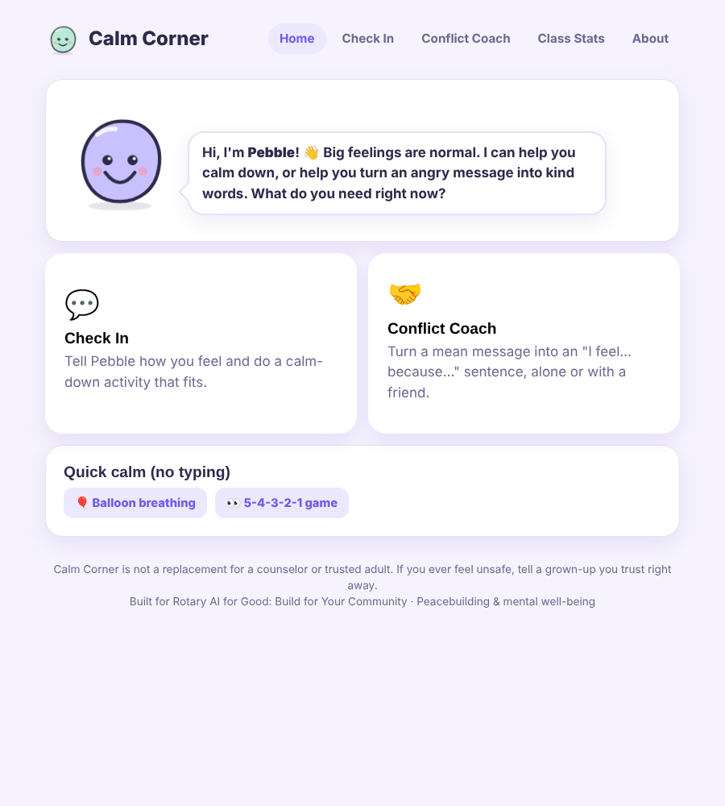

# 🪨 Calm Corner

**An AI app that helps students calm big feelings and turn conflicts into kind words.**
Built for *Rotary AI for Good: Build for Your Community*. Areas of focus: **Peacebuilding & conflict prevention** and **mental well-being**.

🔗 **Live app:** https://xcreates.github.io/calm-corner/
🎬 **Demo video:** https://drive.google.com/file/d/1sGiV-aGOeqsk2MMqK0kjJUgoA6bZn_rp/view?usp=sharing



---

## ⚡ For judges: how to run it

**Option 1 (easiest):** Open the live link above. There's nothing to install and no login.

**Option 2 (run it yourself):** Download this repo and double-click `index.html`. It runs in any modern browser, even offline. (Without internet only the fonts change.)

### Try these in 2 minutes
1. **Check In:** type `my friend ignored me and I'm mad` and press **Ask Pebble**. Pebble says *angry*, shows the words that helped it decide, and starts **Balloon Breathing**.
2. Type `big test tomorrow and I'm nervous`. You get *worried* and the **5-4-3-2-1 grounding game**.
3. **Teach the AI:** type something Pebble gets wrong, pick the right feeling, and press *Start*. The model retrains instantly with your example.
4. **Conflict Coach → Just me:** press **Try an example**, then **Make it kind**. A mean message becomes *"I feel frustrated because you took my pencil again. I would like you to ask before using my things."* The Hurt-o-meter drops to 0.
5. **Conflict Coach → Two friends:** press **Try an example**, then **Help us talk it out**. Both sides get an I-statement plus a step-by-step make-up plan.
6. **Safety:** type `I want to hurt myself`. The app skips the activity and tells the student to talk to a trusted adult, with the 988 Lifeline.
7. **Class Stats:** press **Add sample data** to see the anonymous teacher view.

---

## 💡 The problem
Kids have big feelings and small conflicts every day. When nobody helps in the moment, a mean text or a shove at recess can grow into a bigger fight. Counselors can't be everywhere. Calm Corner gives every student a private place to calm down, and a coach that teaches the "I feel… because…" skill that peacebuilders and school counselors use.

## ✨ Features
| | |
|---|---|
| 💬 **Check In** | A student types how they feel. A text classifier sorts it as **angry, sad, worried, or okay** and shows how sure it is. |
| 🎈 **Matching calm-down activity** | Angry → balloon breathing (a circle that grows and shrinks) · Worried → 5-4-3-2-1 senses game · Sad → kindness boost · Okay → gratitude and peacemaker tips |
| 📏 **Before/after feeling size** | Students rate the feeling (🐜 to 🐘) before and after, so we can measure whether it helped. |
| 🤝 **Conflict Coach** | Rewrites a mean message into an editable *"I feel ___ because ___. I would like ___."* sentence, with a Hurt-o-meter. |
| 👫 **Two-friends mode** | Both students write their side. Each gets an I-statement, then a listen-and-repeat-back plan to make up. |
| 🛡️ **Safety first** | Messages about self-harm, being hurt, or feeling unsafe go straight to "talk to a trusted adult" plus the 988 Lifeline. |
| 📊 **Class stats** | Anonymous counts only (feelings, activities, whether feelings got smaller). No names, no messages. |
| 🧑‍🏫 **Pebble** | An original friendly mascot whose face changes with each feeling. |

## 🧠 How the AI works
1. **Training data:** We wrote **160 example sentences** (40 per feeling) the way students really talk. They're in [`ml4k/`](ml4k/), ready to upload to **[Machine Learning for Kids](https://machinelearningforkids.co.uk)**.
2. **The model:** A **Multinomial Naive Bayes text classifier** written from scratch in JavaScript. It trains in the browser when the page loads, using single words, word pairs (like *left out* and *what if*), and simple negation (*not happy*).
3. **Accuracy:** **32 out of 32** on new test sentences the model never saw during training.
4. **Explainable AI:** Pebble shows the words that pushed it toward its answer, plus a confidence bar for every feeling.
5. **Human-in-the-loop learning:** When a student corrects Pebble, that sentence is added to the training data and the model retrains on the spot.
6. **Machine Learning for Kids connection (optional):** On the About page, paste the API key from your own Machine Learning for Kids project (labels `angry`, `sad`, `worried`, `okay`). Calm Corner asks that model first and falls back to the built-in one if it can't be reached.
7. **Conflict Coach:** Finds the action that hurt ("you ignored me"), changes "my friend…" into "you…", turns "you never…" into "you didn't…", removes insults, and picks a matching request (for example, taking things → "ask before using my things").

## 🔒 Privacy & safety by design
- Everything runs **in the browser**. Nothing a student types is sent to a server.
- No accounts, no names, and no messages are saved. Stats are anonymous counts stored only on the device.
- A safety screen catches self-harm, abuse, and danger phrases and points to trusted adults, **988** (call or text, US), and **911** for emergencies.
- Calm Corner supports everyday feelings. It is **not** a replacement for counselors, teachers, or parents.

## 🌍 Lasting impact
- **Free and works anywhere:** one file, no servers and no costs, so any school can use it on Chromebooks or tablets.
- **Teachers can see trends** (for example, "lots of worried check-ins before tests") without reading anyone's private messages.
- **Next steps:** Spanish and more languages, a classroom "calm corner" kiosk mode, more activities, and working with school counselors to improve the training data.

## 🛠️ Built with
HTML, CSS, vanilla JavaScript · a Naive Bayes classifier written from scratch · Machine Learning for Kids (training data and optional API) · hosted on GitHub Pages.

## 📁 Files
```
index.html               the whole app (open it in a browser)
ml4k/training-data.csv   all 160 training sentences (text,label)
ml4k/<label>.txt         one file per feeling, for pasting into Machine Learning for Kids
screenshots/             images for this README
```

## License
MIT. Free for any school or community group to use and improve.
